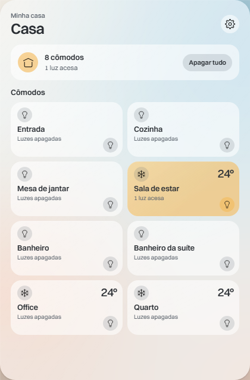

# Smart Home Tray

A Windows system-tray widget, in the spirit of the macOS Control Center, that controls a home's Tuya / Smart Life lights (per room, with groups) and LG ThinQ air conditioners. Electron + TypeScript + React.



## Run

```bash
npm ci
npx electron-vite build
npx electron out/main/index.js
```

Click the tray icon. The first run opens **Configurar**.

## Setup

- **LG ThinQ**: create a personal access token at <https://connect-pat.lgthinq.com> and put it in a `.env` next to the app (`LG_PAT=…`, `LG_COUNTRY=BR`). See `.env.example`.
- **Smart Life / Tuya**: in **Configurar**, paste your Smart Life *User Code* (app → Eu → Configurações → Conta e segurança → Código de usuário), click **Gerar QR Smart Life**, scan the QR code with the Smart Life app, then **Buscar dispositivos** and **Salvar**. Devices and credentials are stored encrypted on this PC (Electron `safeStorage`), never in this repository.

Lights are driven over the LAN when reachable (Tuya protocol 3.3/3.4/3.5) and through the Smart Life cloud otherwise.

## Develop

```bash
sh ci/local-ci.sh        # typecheck, lint, unit tests
npx playwright test      # journeys and interaction checks (fixture mode, no devices)
```

Design notes: `docs/DESIGN.md`. Project brief: `docs/PROJECT.md`. Third-party credits: `docs/CREDITS.md`.

## License

MIT — see `LICENSE`.
